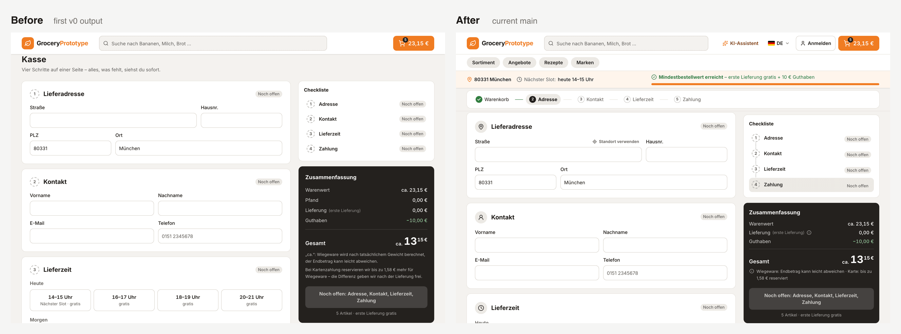

# Grocery first-order prototype

A clickable prototype of a first-order flow for an online grocery shop in Germany. Mock data only — no real orders or payments. Not affiliated with any real shop.

Relevant for grocery-delivery and quick-commerce products, where the first order decides whether a customer comes back.

**Live:** https://grocery-first-order-prototype.vercel.app — works on desktop and mobile. To test delivery, tap the "80331" hint in the first window.

**Case study:** [Design Case Study #12 — First order: show the deal before the cart](https://dribbble.com/shots/27878569-Design-Case-Study-12-First-Order-Show-the-Deal-Before-Cart) on Dribbble

## The idea

New customers build a cart before they know the deal: the minimum order, the delivery fee, the next free slot, and the final price. They learn these rules one by one, close to payment. This prototype shows the deal first and keeps it visible.

## Flow

1. Welcome window — postcode check, then the deal: minimum order, free first delivery, next slot, starting credit.
2. Shopping — the deal bar stays visible with progress to the minimum. "Mit KI auffüllen" suggests items; the customer confirms.
3. Cart — one compact summary, delivery-fee tiers on demand, card hold for weighed items explained in one line. Items grouped by category or as one list.
4. Checkout — one page: a sticky stepper and a checklist with the same steps, three clear states (done / open / error), and an order button that says what's still missing. "Standort verwenden" fills a sample address (demo only).
   
## How it was built

Generated with v0 from one prompt, then reviewed round by round. Each commit after the first is one review round; pull requests #1–#4 sum them up.

Deliberately not built: quantity discounts and an upsell window before checkout.

Every round is listed in [AGENT_LOG.md](AGENT_LOG.md).

### Before / after

Checkout with the same cart, 1280 × 860. Left: the first v0 output (commit `a00284e`). Right: current main.
The review rounds kept the deal visible on checkout (deal bar with progress to the minimum), added a sticky stepper and one icon per section, and cut the summary to one line about weighed items.
The order button already listed what was missing; it stayed, because the customer should see the next step at the point of paying.

## Stack

Next.js, TypeScript, Tailwind. Business rules in `config.ts`, mock products in `data/products.ts`.

## License

MIT, see [LICENSE](LICENSE).
